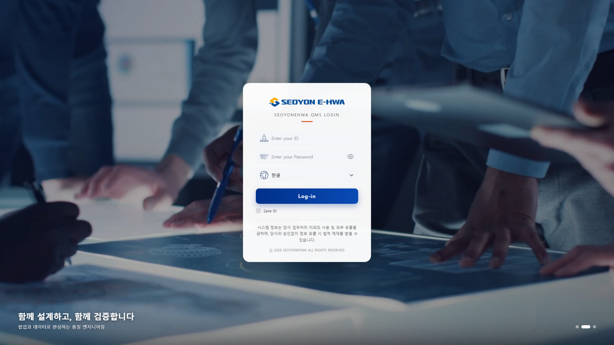
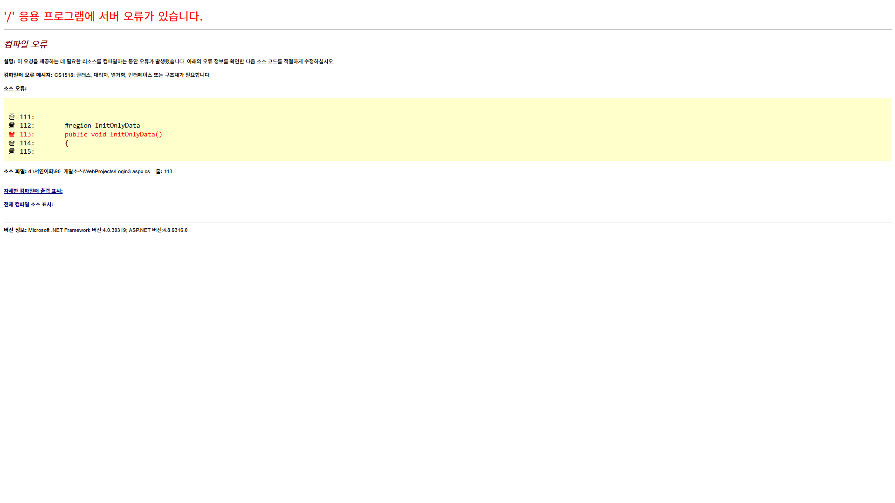

# SEOYON E-HWA QMS 로그인 페이지 시안 (3종)

ASP.NET WebForms(웹사이트 프로젝트) 기반 QMS 로그인 화면 시안 3종입니다.
**온라인 목업 (GitHub Pages):** https://zerosr0.github.io/seoyonehwa-login-drafts/ — 서버 없이 화면 동작(슬라이드, 비밀번호 보기)을 바로 볼 수 있습니다. 정적 HTML 버전은 `docs/` 폴더입니다.

세 시안 모두 같은 마크업/JS를 쓰고 CSS만 다르며, 배경 이미지 3장이 4초 간격으로 크로스페이드됩니다.

| 시안 | 파일 | 특징 |
| --- | --- | --- |
| 1. 슬라이드형 | `Login1.aspx` / `Login1.css` | 좌측 로그인 카드 + 우측 사선 배경 슬라이드, 하단 슬로건 |
| 2. 중앙 카드형 | `Login2.aspx` / `Login2.css` | 전체 화면 배경 슬라이드(남색 오버레이) + 정중앙 카드 |
| 3. 다크 테마 | `Login3.aspx` / `Login3.css` | 좌측 어둡게 처리한 슬라이드 + 우측 다크 패널 폼, 오렌지 포인트 |

## 스크린샷

### 시안 1 — 슬라이드형


### 시안 2 — 중앙 카드형


### 시안 3 — 다크 테마


## 폴더 구조

```
WebProjects/
  Login1.aspx, Login1.aspx.cs      시안 1
  Login2.aspx, Login2.aspx.cs      시안 2
  Login3.aspx, Login3.aspx.cs      시안 3
  CommonScripts/Css/Login1~3.css   시안별 스타일
  Images/Login_New_Images/         슬라이드 이미지(login_slide1~3.jpg), 아이콘
screenshots/                       headless Edge 로 찍은 결과 화면
```

## 적용 방법

1. `WebProjects/` 아래 파일을 QMS 웹사이트 프로젝트의 같은 경로에 복사합니다.
2. `http://<site>/Login1.aspx`, `/Login2.aspx`, `/Login3.aspx` 로 접속해 비교합니다.
3. 슬라이드는 각 aspx 의 `<ul class="login_bg">` 안 `<li>` 를 추가·삭제하고, 문구는 `<figcaption>` 에서 수정합니다.
   전환 주기는 스크립트의 `BG_SLIDE_INTERVAL`(ms), 페이드 시간은 CSS 변수 `--slide-fade` 입니다.

## 구현 메모

- 로그인/OTP 처리 WebMethod(`LoginProc`, `ChkUseOtp`, `RegOtp`)는 기존 `Login.aspx` 의 것을 그대로 호출합니다.
  시안 코드비하인드는 CI·타이틀·저작권 초기화만 담당합니다.
- 프레임워크 `BaseForm` 의 세션검사 예외 목록이 `login.aspx` 로 고정되어 있어
  시안 페이지는 `System.Web.UI.Page` 를 직접 상속합니다. 최종 선택본을 `Login.aspx` 에 병합할 때 `BaseForm` 상속으로 되돌리면 됩니다.
- 시안 3 은 남색 CI 로고를 `legend { filter: brightness(0) invert(1) }` 로 흰색 반전합니다.
- 신규 파일은 UTF-8 BOM + CRLF 입니다.
